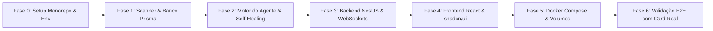

# Roadmap de Desenvolvimento: Agente Autônomo de Backend & Aplicação Web

Este documento estabelece o planejamento sequencial, marcos de entrega (milestones) e critérios de aceite para a implementação completa do **Agente de Backend** e da **Aplicação Web Local (Docker Compose)**.

---

## 1. Visão Geral das Fases

---

## 2. Detalhamento das Fases de Implementação

### 📌 Fase 0: Setup Inicial do Monorepo e Ambiente
* **Objetivo:** Estabelecer a infraestrutura de código base, gerenciamento com `pnpm workspace` e validação das credenciais.
* **Tarefas:**
  - [ ] Inicializar workspace `pnpm` (`pnpm-workspace.yaml`, pastas `apps/api` e `apps/web`).
  - [ ] Configurar TypeScript base, ESLint e Prettier padronizados.
  - [ ] Configurar `.env` central e scripts de validação de tokens (Kanbanize, Gemini, Azure CLI).
* **Critério de Sucesso:** Monorepo configurado, dependências instaladas via `pnpm install` sem erros e credenciais testadas via scripts rápidos.

---

### 📌 Fase 1: Camada de Dados e Scanner Estrutural de Repositórios
* **Objetivo:** Criar o banco de dados PostgreSQL local com Prisma ORM e o módulo de scanner determinístico para repositórios locais.
* **Tarefas:**
  - [ ] Modelar o schema Prisma com tabelas `RepositoryProfile` e `TaskExecution`.
  - [ ] Executar migrations do Prisma no PostgreSQL local.
  - [ ] Implementar o serviço de Scanner de Repositórios (`RepositoryScannerService`):
    - Extração de `package.json` (dependências, linter, test runner, scripts).
    - Mapeamento de diretórios centrais (`src/modules`, `prisma/`, etc.).
    - Obtenção do hash do último commit (`git rev-parse HEAD`).
  - [ ] Implementar lógica de cache: reutilizar perfil salvo no banco se o hash do commit não mudou.
* **Critério de Sucesso:** O scanner inspeciona um repositório local de teste em menos de 1 segundo e grava/atualiza o perfil no banco sem gastar tokens de IA.

---

### 📌 Fase 2: Motor Central do Agente Backend (CLI & Self-Healing)
* **Objetivo:** Implementar o fluxo do agente com integração com Kanbanize, Gemini API e loop de testes com auto-correção.
* **Tarefas:**
  - [ ] Implementar cliente REST do Kanbanize para busca de cards (título, descrição, critérios).
  - [ ] Desenvolver gerador de diagnósticos técnicos injetando o perfil estrutural do repositório no prompt do Gemini 2.5 Pro.
  - [ ] Implementar portão de aprovação Human-in-the-Loop no terminal (CLI interativo `s/n`).
  - [ ] Implementar execução Git (criação da branch `feat/card-<ID>`, checagem de working tree limpa).
  - [ ] Implementar motor de escrita de arquivos baseados nas regras do repositório (ex.: NestJS + Zod).
  - [ ] Desenvolver **Self-Healing Loop**:
    - Rodar `pnpm run lint --fix`.
    - Rodar `pnpm test`.
    - Em caso de falha nos testes, reenviar o traceback de erro para a LLM refatorar os arquivos (limite de 2 tentativas).
  - [ ] Implementar push Git e criação automática de PR no Azure DevOps via `az repos pr create`.
* **Critério de Sucesso:** Um card de teste do Kanbanize é processado via CLI, gerando código no padrão do repositório, passando nos testes com sucesso e abrindo PR no Azure DevOps.

---

### 📌 Fase 3: Backend da Aplicação Web (NestJS & Gateway em Tempo Real)
* **Objetivo:** Criar a API NestJS que orquestra o agente e expõe eventos em tempo real para a interface web.
* **Tarefas:**
  - [ ] Estruturar a aplicação NestJS em `apps/api` (Módulos: `Agent`, `Repository`, `Task`, `Gateway`).
  - [ ] Conectar NestJS ao banco PostgreSQL via `PrismaModule`.
  - [ ] Implementar endpoints REST:
    - `GET /repositories`: Listar repositórios detectados e status de cache.
    - `POST /repositories/scan`: Forçar re-escaneamento de um repositório.
    - `POST /tasks/start`: Iniciar tarefa informando Card ID e repositório alvo.
    - `POST /tasks/:id/approve`: Decisão de aprovação do diagnóstico (Human-in-the-Loop).
    - `GET /tasks/history`: Listar histórico de execuções e links de PRs.
  - [ ] Configurar Gateway WebSocket (Socket.io) para streaming de stdout/stderr de comandos e logs do agente linha a linha.
* **Critério de Sucesso:** Endpoint REST e WebSockets testados localmente, transmitindo logs e aguardando resposta de aprovação via chamada de API.

---

### 📌 Fase 4: Frontend Web (React + Vite + Tailwind + shadcn/ui)
* **Objetivo:** Desenvolver uma interface moderna, intuitiva e reativa para operação diária do agente.
* **Tarefas:**
  - [ ] Inicializar app React + Vite com TypeScript e Tailwind CSS em `apps/web`.
  - [ ] Configurar e instalar componentes `shadcn/ui` (Button, Card, Dialog, Badge, Table, Tabs, Alert).
  - [ ] Construir tela **Dashboard de Repositórios**:
    - Cards visuais com métricas de cada projeto (framework, validação, data da última análise).
    - Botão de sincronização/varredura rápida.
  - [ ] Construir tela **Execução de Tarefa**:
    - Input de Card ID com busca prévia no Kanbanize.
    - Seletor de repositório vinculado.
    - Visualizador de Diagnóstico formatado em Markdown com botões de aprovação destacados.
    - Componente de Terminal escuro para logs em tempo real (via Socket.io).
  - [ ] Construir tela **Histórico de Tarefas & PRs**:
    - Status de cada execução (Aprovado, Concluído, Falhou) e link direto para o Azure DevOps.
* **Critério de Sucesso:** Usuário consegue acionar a tarefa pelo navegador, ler o diagnóstico, aprovar a execução e acompanhar os testes rodando no terminal web.

---

### 📌 Fase 5: Dockerização e Orquestração (Docker Compose)
* **Objetivo:** Empacotar toda a solução para que possa ser inicializada com um único comando `docker compose up`.
* **Tarefas:**
  - [ ] Escrever `apps/api/Dockerfile` com suporte a Node.js 20, pnpm, Git e Azure CLI.
  - [ ] Escrever `apps/web/Dockerfile` otimizado para o frontend Vite.
  - [ ] Configurar `docker-compose.yml`:
    - Serviço PostgreSQL com volume local nomeado.
    - Serviço Backend montando o diretório de repositórios do host (`HOST_REPOS_PATH ➔ /workspace/repos`).
    - Montagem das credenciais do Git (`~/.gitconfig`) e Azure CLI (`~/.azure`) para preservar autenticação do usuário.
    - Serviço Frontend conectado à rede interna do Compose.
  - [ ] Testar persistência de dados do banco ao reiniciar contêineres.
* **Critério de Sucesso:** Execução limpa de `docker compose up --build` com todos os 3 serviços saudáveis (healthy) e comunicação operacional.

---

### 📌 Fase 6: Validação End-to-End (E2E) e Refinamentos Finais
* **Objetivo:** Realizar o ciclo completo da ferramenta em um cenário real de desenvolvimento.
* **Tarefas:**
  - [ ] Criar um card de funcionalidade de backend real no Kanbanize.
  - [ ] Disparar a tarefa pela interface web (`http://localhost:3000`).
  - [ ] Validar a leitura correta do repositório local montado e do cache no Postgres.
  - [ ] Avaliar a precisão do diagnóstico gerado pela LLM.
  - [ ] Aprovar pelo painel web e validar a geração dos arquivos, schemas Zod e testes.
  - [ ] Conferir o Pull Request gerado no Azure DevOps.
  - [ ] Documentar guia de operação diária e atalhos úteis.
* **Critério de Sucesso:** PR criada e revisada com sucesso no Azure DevOps sem necessidade de correção manual de lint ou testes.
